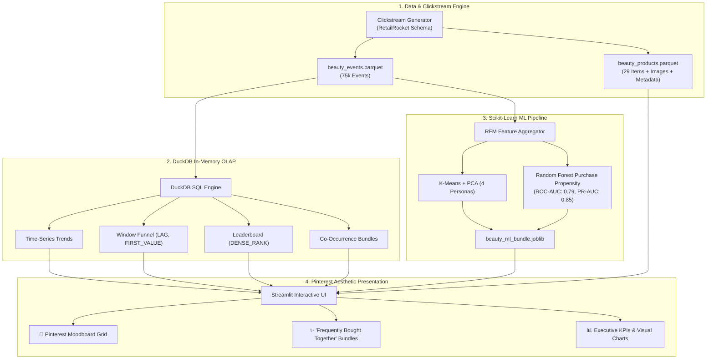

# 💄 Blush & Basket (Beauty E-Commerce Intelligence)

An elegant, production-grade **E-Commerce Data Analytics & Machine Learning Platform** modeled on the **RetailRocket eCommerce Clickstream Schema** with an authentic Nykaa beauty context (*Lipsticks, Foundations, Serums, Sunscreens, Moisturizers, Haircare, Fragrances*).

Built with **DuckDB In-Memory Analytical SQL**, **Scikit-Learn (K-Means, PCA, Random Forest)**, and **Streamlit** styled in a **Pinterest Moodboard Aesthetic** with curated beauty photography.

---

## 📖 What This Project Is All About

Modern e-commerce analytics requires bridging the gap between raw clickstream event ingestion, lightning-fast analytical queries, customer journey diagnosis, and real-time machine learning predictions. 

This platform processes **75,000+ clickstream events** across **4,500 unique beauty shoppers** and **29 products** to answer critical commercial questions:
1. **Journey & Funnel Conversion:** Where do customers abandon the purchase journey? (*Views vs. Cart Additions vs. Completed Orders*)
2. **Merchandising Opportunity Matrix:** Which products are *Stars* (high views, high conversion) vs. *Hidden Gems* (low views, high conversion) vs. *Traffic Traps*?
3. **Behavioral Personas (Unsupervised ML):** How do customer engagement and spend patterns group into actionable marketing segments?
4. **Purchase Propensity (Supervised ML):** Can we predict if a browsing visitor will complete an order based on real-time browsing telemetry?
5. **Routine Bundling (Market Basket Recommendation):** Which products have the highest co-occurrence affinity to power *"Frequently Bought Together"* bundles?

---

## 🎨 Pinterest Aesthetic Design System

The UI is crafted with a high-end beauty moodboard aesthetic inspired by Pinterest boards, editorial fashion layouts, and Sephora/Nykaa luxury branding:

| Visual Element | Palette Name | Hex Code | Description |
|---|---|---|---|
| **App Canvas** | Soft Ivory Blush | `#FFF8FA` | Gentle, warm moodboard gradient |
| **Typography & Headings** | Plum Luxe | `#241126` | Editorial serif (`Playfair Display`) & sans (`Plus Jakarta Sans`) |
| **Primary Action Accent** | Berry Rose | `#C0266D` | High-intent call-to-actions, badges, and highlights |
| **Secondary Accent** | Rosy Pink | `#E879A8` | Conversion pills, hover states, and trend lines |
| **Borders & Badges** | Pastel Lilac | `#F3D5E5` | Delicate glassmorphism card outlines and dividers |
| **Card Canvas** | Pure White Glass | `#FFFFFF` | Elevated cards with `0 10px 30px rgba(192, 38, 109, 0.05)` shadow |

---

## 🏗️ System Architecture



---

## 📊 The 7 Analytics Priorities & Demonstrated Skills

| Priority | Feature / Module | Demonstrated Technical Skill | Description |
|---|---|---|---|
| **1** | **Daily Event Trend** | Pandas, SQL, Time-Series Aggregation | Multi-line interactive trend tracking daily Views, Bag Adds, and Orders. |
| **2** | **Full-Funnel Conversion** | Business Metrics, CTEs, Window Functions | Funnel drop-offs (`LAG()`, `FIRST_VALUE()`) and conversion leakage analysis. |
| **3** | **Top Products Leaderboard** | SQL Aggregation & `DENSE_RANK()` | Revenue podium with visual product thumbnails and commercial metrics. |
| **4** | **Engagement Quad-Matrix** | Quad-Matrix Merchandising Strategy | Interactive scatter plot categorizing products into *Stars*, *Hidden Gems*, etc. |
| **5** | **Customer Segmentation** | Unsupervised ML (K-Means & PCA) | 4 customer personas clustered by RFM behavioral telemetry in 2D PCA space. |
| **6** | **Purchase Propensity Model** | Supervised ML & Model Validation | Random Forest classifier evaluated via ROC Curve, PR Curve, and Feature Attribution. |
| **7** | **Co-Occurrence Heatmap & Bundles** | Recommendation Systems (Market Basket) | 12x12 interaction matrix powering *"Frequently Bought Together"* routine bundles. |

---

## 📊 Tableau & Power BI Ready Datasets

This project includes pre-aggregated, star-schema datasets ready to drag-and-drop into **Tableau Desktop**, **Tableau Public**, or **Power BI**:

| File | Rows | Granularity | Key BI Visualizations |
|---|---|---|---|
| [`tableau_sales_orders.csv`](file:///d:/projects/beauty/BeautyDashBoard/data/tableau_sales_orders.csv) | 4,471 | Order Line | Revenue over time, Category share of wallet, Brand ranking |
| [`tableau_customer_rfm.csv`](file:///d:/projects/beauty/BeautyDashBoard/data/tableau_customer_rfm.csv) | 4,500 | Customer | RFM Treemap, Customer Lifetime Value, Churn Risk scatter |
| [`tableau_cohort_retention.csv`](file:///d:/projects/beauty/BeautyDashBoard/data/tableau_cohort_retention.csv) | 64 | Cohort Week | Weekly Cohort Retention Heatmap (Decay curve) |
| [`tableau_funnel_daily.csv`](file:///d:/projects/beauty/BeautyDashBoard/data/tableau_funnel_daily.csv) | 60 | Date | Daily multi-line time series (Views, Bag Adds, Orders) |

### 🛠️ Pre-Calculated Tableau LOD Formulas
Tested Level of Detail expressions included in the dashboard:
- **Customer Acquisition Date:** `{FIXED [Visitor ID]: MIN([Date])}`
- **Customer Lifetime Spend:** `{FIXED [Visitor ID]: SUM([Line Revenue])}`
- **Repeat Buyer Flag:** `IF {FIXED [Visitor ID]: COUNTD([Transaction ID])} > 1 THEN "Repeat Customer" ELSE "One-Time Buyer" END`
- **Week Offset for Retention:** `DATEDIFF('week', [Customer Acquisition Date], [Date])`

---

## 💼 Data Analyst Job & Interview Toolkit

- 📄 **[DATA_ANALYST_PORTFOLIO.md](file:///d:/projects/beauty/BeautyDashBoard/DATA_ANALYST_PORTFOLIO.md)**: Ready-to-copy resume bullet points (Google XYZ format), STAR interview stories, and Top 5 technical interview Q&A.
- 🗄️ **[queries/data_analyst_case_study.sql](file:///d:/projects/beauty/BeautyDashBoard/queries/data_analyst_case_study.sql)**: Production SQL showcase demonstrating CTEs, Window Functions (`NTILE(5)`, `LAG`, `FIRST_VALUE`), date truncations, and Market Basket self-joins.

---

## 🚀 Quickstart & Deployment

### Option A: Local Python Run

```powershell
# 1. Clone repository
git clone https://github.com/preetikaanjana/BlushAndBasket.git
cd BlushAndBasket

# 2. Install dependencies
pip install -r requirements.txt

# 3. Launch Streamlit
streamlit run app.py
```
Open your browser at: `http://localhost:8501`

---

### Option B: Docker & Docker Compose (Production Ready)

Single-command containerized deployment:

```bash
docker compose up --build
```
The application will be accessible at: `http://localhost:8501` (includes built-in healthchecks).

To run with plain Docker:
```bash
docker build -t beauty-commerce-intelligence .
docker run -p 8501:8501 beauty-commerce-intelligence
```

---

### Option C: 1-Click Streamlit Community Cloud

1. Fork or push to your GitHub repository.
2. Sign in to [share.streamlit.io](https://share.streamlit.io/).
3. Click **New app**, select `BeautyDashBoard`, set main file path to `app.py`.
4. Click **Deploy!** (Data and ML models auto-initialize on cold start).

---

### Option D: Render / Railway Deployment

The repository includes pre-configured `render.yaml` and `Procfile`.
- On **Render**: Create a New Web Service, connect your GitHub repo, and Render will automatically detect `render.yaml` and deploy on Python 3.12.
- On **Railway / Heroku**: Connect repository; the `Procfile` declares the web worker and binds to `$PORT`.

---

## 📂 Project Structure

```text
BlushAndBasket/
├── .streamlit/
│   └── config.toml             # Theme palette & server settings
├── data/
│   ├── beauty_events.parquet   # 75,000 clickstream interaction logs
│   ├── beauty_products.parquet # 29 beauty items with imagery & tags
│   ├── tableau_sales_orders.csv# Star-schema orders extract for Tableau
│   ├── tableau_customer_rfm.csv# Customer RFM scores (1-5) for Tableau
│   ├── tableau_cohort_retention.csv # Cohort decay matrix for Tableau
│   └── tableau_funnel_daily.csv# Daily funnel metrics for Tableau
├── models/
│   └── beauty_ml_bundle.joblib # Serialized K-Means, PCA, & Random Forest models
├── queries/
│   └── data_analyst_case_study.sql # Production SQL showcase (CTEs, Window funcs)
├── app.py                      # Main Streamlit Pinterest application
├── data_generator.py           # Clickstream & catalog generator
├── duckdb_engine.py            # High-performance analytical SQL queries
├── ml_models.py                # K-Means clustering & Random Forest training
├── product_images.py           # Curated aesthetic imagery registry & metadata
├── DATA_ANALYST_PORTFOLIO.md   # Resume bullets, STAR stories, & interview Q&A
├── Dockerfile                  # Multi-stage production container
├── docker-compose.yml          # Container orchestration
├── .dockerignore               # Docker build context filters
├── Procfile                    # Cloud process declaration
├── render.yaml                 # Render cloud blueprint
├── requirements.txt            # Python dependencies
└── README.md                   # Full documentation & architecture guide
```

---

## 👩‍💻 Author & Credits

- Modeled on the **RetailRocket eCommerce Clickstream Dataset** benchmark.
- Nykaa & Sephora cosmetics catalog inspiration.
- Built with **Python 3.12**, **DuckDB SQL**, **Tableau**, **Scikit-Learn**, **Plotly**, and **Streamlit**.
